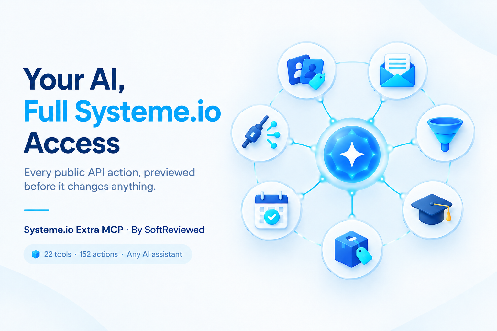
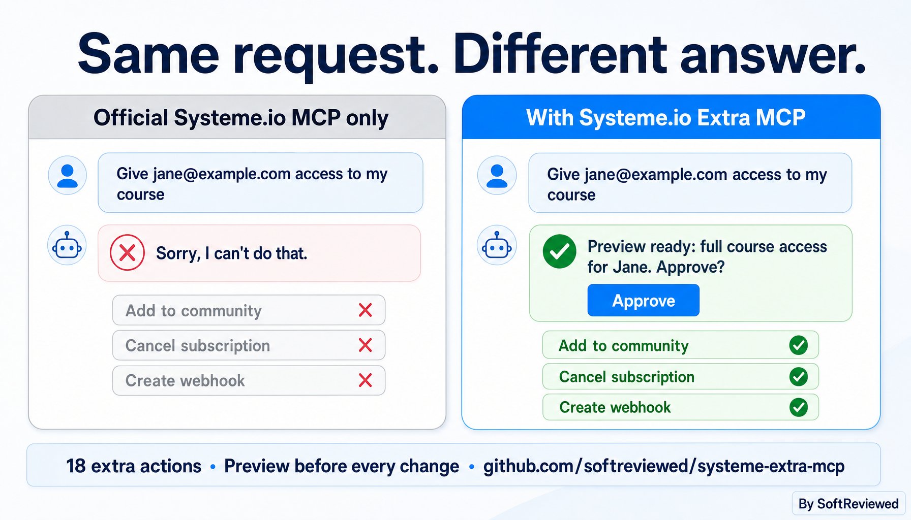
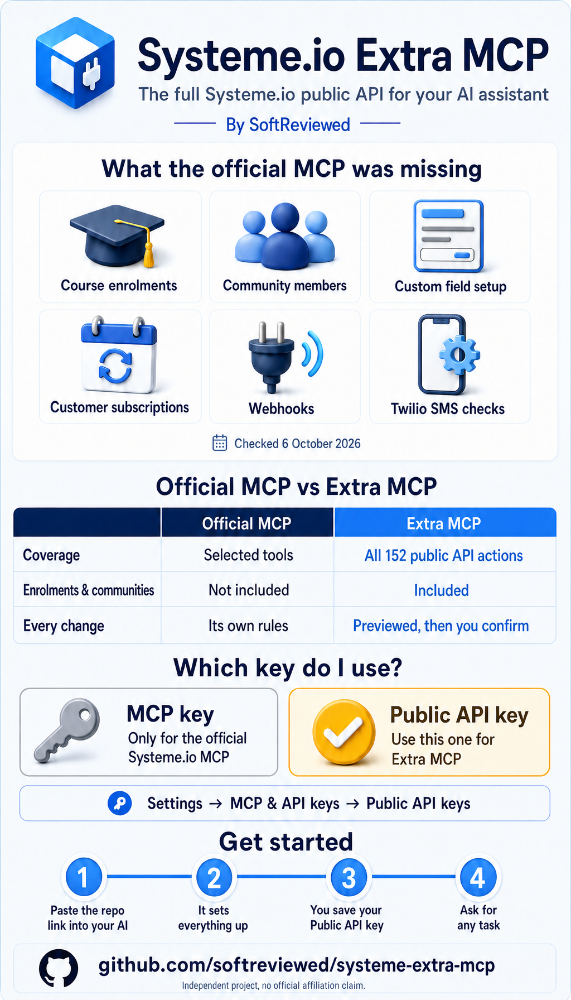
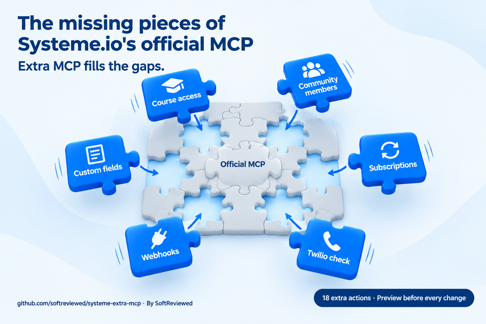
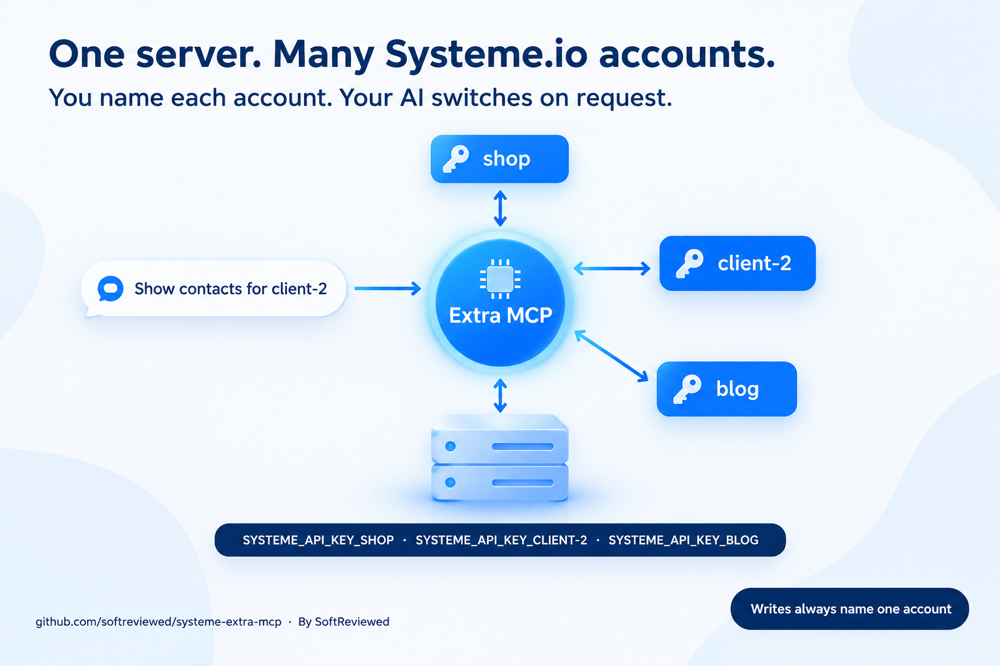

# Systeme.io MCP Server: Use AI to Automate Sales Funnels, Email Marketing and CRM



**Run your Systeme.io account from your AI assistant: contacts, tags, funnels, pages, emails, courses, products, payments and more.**

Systeme.io Extra MCP covers **every endpoint in Systeme.io's public API documentation**: 152 actions in 22 tool groups. It works on its own, without the official Systeme.io MCP, and connects to assistants such as Claude, Codex, Antigravity and Cursor.



> 🚀 **Don't have an account yet? [Create your free Systeme.io account](https://systeme.io/?sa=sa014961805313a1b0df13d9b881e5c0c4563dda8f)** to get started with the platform. Already have one? Use your existing account.

*Affiliate link: SoftReviewed may earn a commission from eligible purchases.*

Here, automation means asking a connected assistant to perform supported actions; it does not mean an unattended business that runs without your instructions or review.

Built by SoftReviewed. Independent project; not endorsed by Systeme.io.



## Quick start: let your AI install it

1. Create a **Public API key** in Systeme.io: **Settings -> MCP & API keys -> Public API keys -> Create**. (Not the MCP key on the same page; that one only works for the official MCP.)
2. Paste this into your AI assistant (Claude Code, Codex, Cursor, Antigravity and similar tools that can run commands):

> Install https://github.com/softreviewed/systeme-extra-mcp for me. Follow its AGENTS.md. Keep my other MCP servers. Do not ask me to paste my API key in chat.

3. Save your key when the assistant asks (a hidden prompt, or one line in your config file), then restart the app.
4. Ask: **"List my Systeme.io tags."** If you see your tags, you are ready.

The assistant picks the setup that fits your computer:

| Your computer has | Setup used | Where the key is kept |
|---|---|---|
| Docker Desktop with MCP Toolkit | Docker Gateway | Docker's secret store (safest) |
| Python 3.11 or newer | Direct Python | Your assistant's config file |

Prefer to do it yourself? Follow [Connect your assistant](#connect-your-assistant).

## Guide

- [Quick start](#quick-start-let-your-ai-install-it)
- [What you can do](#what-you-can-do)
- [Official Systeme.io MCP or this one?](#official-systemeio-mcp-or-this-one)
- [Is it right for you?](#is-it-right-for-you)
- [Connect Systeme.io to Claude, Codex, Antigravity or Cursor](#connect-your-assistant)
- [Technical reference](#technical-reference)
- [Troubleshooting](#troubleshooting)
- [Verification limits](#verification-limits)

## Why use it?

You want to tag a customer, check last week's newsletter results, give a student course access and pause a coupon. Normally that is four dashboard screens.

With this server your assistant can do all of it in one conversation. Every change is previewed first, and nothing is written until you say yes.

**Your request -> assistant finds the right record -> previews the change -> you authorize it -> account updated.**

An assistant still needs accurate instructions and your review. The connection does not replace your judgement or guarantee that an assistant selects the right customer.

## What you can do

| Area | Tool groups | Examples |
|---|---|---|
| Contacts and CRM | `contacts`, `tags`, `contact_fields` | Find a contact by email, add or remove tags, define custom fields |
| Automation | `automation_rules`, `automation_emails` | List, create and edit rules; manage automation emails |
| Funnels and pages | `funnels`, `pages` | List funnels and steps, create a step, read or save page content, apply a template |
| Email marketing | `newsletters`, `campaigns`, `email_statistics` | Draft, target, schedule, test and send newsletters; edit campaign steps; read open and click stats |
| Courses and community | `courses`, `enrolments`, `communities` | Build courses, modules and lectures; grant or remove access; manage community members |
| Selling | `products`, `price_plans`, `coupons`, `sale_settings`, `subscriptions` | Manage digital and physical products, offers, prices and coupons; cancel a customer subscription |
| Scheduling | `booking` | Read bookings; manage calendar events and availability |
| Integrations | `webhooks`, `sms` | Manage event webhooks; check Twilio setup and SMS templates |
| Account | `account` | List connected domains and uploaded files |

Every action, its method, path and required inputs are listed in the [feature reference](docs/feature-reference.md). Ask the assistant for `help` on any group to see the same list.

### Example requests

- **"Find the contact jane@example.com and preview adding the tag Customer."**
- **"Show open and click rates for my last three newsletters."**
- **"Preview a 20% coupon for my course, valid until the end of the month."**
- **"Show who has access to this course, then preview giving this customer access."**
- **"Find this customer's subscription and preview cancelling it at the end of the billing period."**

### Safety built in

| Type of action | What happens |
|---|---|
| Read | Runs straight away |
| Write | Blocked until previewed (`dry_run`) and confirmed (`confirm`) after you agree |
| High-impact write | Same gate, flagged as `high_impact` in help: sending a newsletter, deleting contacts, courses, campaigns or products, cancelling a subscription, overwriting a page |

Only documented endpoints are allowed. Two deprecated endpoints (`PUT` newsletter and coupon updates) are left out in favour of their `PATCH` versions.

## Official Systeme.io MCP or this one?



| | Official Systeme.io MCP | Systeme.io Extra MCP |
|---|---|---|
| Coverage | Its own selected tool set | Every endpoint in the public API docs (152 actions) |
| Course enrolments, community members, custom field definitions, subscriptions, webhooks, Twilio checks | Not in the inventory we inspected | Included |
| Hosting | Hosted by Systeme.io | Runs on your computer (Docker Gateway or direct Python) |
| Credential | Official MCP key | Public API key (Docker's secret store or your config file) |
| Write protection | Its own rules | Preview, then explicit confirm for every write |

You can use either one alone or both together. See the [official Systeme.io MCP overview](https://systeme.io/mcp) for what it offers. The official inventory was inspected on **6 October 2026**; it may change.

**Which key?** The official MCP uses an **MCP key**. This server uses a **Public API key**. Both are under **Settings -> MCP & API keys**, in separate lists.

## Is it right for you?

### Advantages

- **The whole public API in one connection:** 22 tool groups across contacts, email, funnels, courses and payments.
- **Works without the official MCP:** useful when you want one local connection for every assistant.
- **Preview before changing account data:** every write is previewed and needs your go-ahead.
- **Two ways to install:** Docker Gateway keeps the key in Docker's secret store; direct Python needs no Docker at all.
- **Portable setup:** rebuild the image and recreate your secret when moving computers.

### Trade-offs and limitations

- **Setup takes a few minutes.** You need Docker Desktop or Python 3.11+, and a Systeme.io Public API key. An assistant that can run commands can do the setup for you.
- **Not every action is tested live.** All 152 are checked offline; live checks cover read actions only. See [verification limits](#verification-limits).
- **Only what the API offers.** Anything missing from Systeme.io's public API (for example, refunds or sending a single SMS) is missing here too.
- **Your account's limits still apply.** It does not unlock paid features, raise capacity or bypass permissions.
- **No built-in cloud hosting.** It runs on your computer; a cloud-only assistant needs a separately hosted, authenticated connection.

## New to Systeme.io?

You need a Systeme.io account before this server can work with your data. [Create a free Systeme.io account](https://systeme.io/?sa=sa014961805313a1b0df13d9b881e5c0c4563dda8f), then learn the dashboard before connecting an assistant to customer records.

For a small starting project, read our [Systeme.io free-plan features and limits guide](https://pricing-discount.systeme.io/free-plan-lifetime-deal). If you later need more capacity, compare the [Systeme.io pricing plans](https://pricing-discount.systeme.io/plan-pricing) and our explanation of [annual discounts and savings](https://pricing-discount.systeme.io/). A higher plan should solve a real capacity need; installing this MCP does not itself require you to upgrade.

If your goal is to build funnels for yourself or clients, our [Systeme.io Funnel Builder certification guide](https://www.linkedin.com/pulse/systemeio-funnel-builder-certification-free-course-beginners-george-8s71f/) covers that learning path. You can also [compare the two Systeme.io certification courses](https://pricing-discount.systeme.io/courses) before choosing where to start.

You can also visit [SoftReviewed](https://softreviewed.com/) for additional resources.

**Affiliate disclosure:** SoftReviewed may earn a commission from eligible purchases made through its referral links. This does not make the MCP an official Systeme.io product.

## Let your assistant handle the setup details

Share this repository URL with your assistant and use the prompt from the [Quick start](#quick-start-let-your-ai-install-it). Step-by-step instructions written for assistants are in [AGENTS.md](AGENTS.md): how to choose Docker or direct Python, where each app keeps its config, how to store the key safely and how to check it works.

An assistant can read the instructions, but it needs to be able to run commands on your computer to set it up (for example Claude Code, Codex, Cursor or Antigravity). A chat-only assistant can still walk you through the steps. Never put your API key into a public issue or commit.

The remaining sections are for installation and technical reference. Exact action names, required inputs and edge cases are in the [detailed feature reference](docs/feature-reference.md); copyable requests are in [the operation examples](examples/operations.json).

## Connect your assistant

Two ways to run it. Both give the same 22 tools.

| | Option A: Docker Gateway | Option B: Direct Python |
|---|---|---|
| You need | Docker Desktop with MCP Toolkit | Python 3.11 or newer |
| Key stored in | Docker's secret store | Your assistant's config file |
| Best for | Keeping keys out of config files; sharing one Gateway | The quickest setup, no Docker |

Option A: Assistant -> Docker Gateway -> container -> Systeme.io API.
Option B: Assistant -> Python on your computer -> Systeme.io API.

### Option A: Docker Gateway

Install/start Docker Desktop with MCP Toolkit/Gateway available. From this repository, check the CLI and build the image:

```sh
docker version
docker mcp gateway run --help
docker build -t mcp-systeme-extra:v2 .
```

The image includes its source and schemas; clients need no source-folder mounts or local Python installation. Copy `docker-catalog.yaml` to `~/.docker/mcp/catalogs/systeme-extra.yaml` (Windows: `%USERPROFILE%\.docker\mcp\catalogs\systeme-extra.yaml`), creating the folder if needed.

```powershell
New-Item -ItemType Directory -Force "$env:USERPROFILE\.docker\mcp\catalogs" | Out-Null
Copy-Item -LiteralPath .\docker-catalog.yaml -Destination "$env:USERPROFILE\.docker\mcp\catalogs\systeme-extra.yaml"
```

Check discovery:

```sh
docker mcp gateway run --catalog systeme-extra.yaml --servers systeme-extra --dry-run
```

Expected: 22 tools, named `systeme_extra_<group>`. Explicit `--servers` selects this server without relying on the enabled-server registry. For an existing shared Gateway, merge the catalog entry, preserve other servers and reuse the existing client connection instead of adding duplicates.

The catalog workflow was tested with the installed CLI. Newer Docker Toolkit profile workflows may differ; inspect your installed `docker mcp gateway run --help`. [Docker MCP documentation](https://docs.docker.com/ai/mcp-catalog-and-toolkit/).

### Credentials

> 🚀 **New to Systeme.io? [Create your free account here](https://systeme.io/?sa=sa014961805313a1b0df13d9b881e5c0c4563dda8f)**, then follow the API-key steps below. Already registered? Go straight to your settings.

*Affiliate link: SoftReviewed may earn a commission from eligible purchases.*

Before using account actions, create your own **public API key**:

1. Sign in and open [Systeme.io API-key settings](https://systeme.io/dashboard/profile/public-api-settings?sa=sa014961805313a1b0df13d9b881e5c0c4563dda8f), or use your profile picture -> **Settings -> MCP & API keys**.
2. In **Public API keys**, select **Create**. Give it a recognizable name such as `Systeme.io Extra MCP`, choose an expiration appropriate for your setup, then save.
3. Store the key securely using the connection method below. The official MCP credential is a different key and cannot replace this public API credential.
4. Start with help, a preview and a harmless account read before requesting changes. Help and previews can run without the key; account reads and writes need it.

See the [official API-key guide](https://help.systeme.io/article/2323-how-to-use-systeme-io-public-api) if the dashboard labels change. Never post the key in a GitHub issue, screenshot or public file. Remove/revoke it in your account when you no longer use this connection.

For Docker Gateway, store it as Docker secret `systeme.api_key`, injected as `SYSTEME_API_KEY`.

PowerShell input avoids placing the key in command history:

```powershell
$systemeSecureKey = Read-Host "Systeme.io public API key" -AsSecureString
$systemeKeyPointer = [Runtime.InteropServices.Marshal]::SecureStringToBSTR($systemeSecureKey)
try {
    [Runtime.InteropServices.Marshal]::PtrToStringBSTR($systemeKeyPointer) | docker mcp secret set systeme.api_key
} finally {
    [Runtime.InteropServices.Marshal]::ZeroFreeBSTR($systemeKeyPointer)
    Remove-Variable systemeSecureKey, systemeKeyPointer
}
```

With Option A, no credentials belong in client JSON. With Option B, the key sits in your assistant's config file on your computer only; never commit or share that file. Help and previews work without credentials; account requests do not.

### Option B: Direct Python (no Docker)

Download the code and install its requirements once:

```sh
git clone https://github.com/softreviewed/systeme-extra-mcp.git
cd systeme-extra-mcp
python -m venv .venv
```

Then, on Windows: `.venv\Scripts\python -m pip install -r requirements-lock.txt`. On macOS/Linux: `.venv/bin/python -m pip install -r requirements-lock.txt`.

Add this entry to your assistant's config, using the full path to your folder. On Windows the Python path ends in `.venv/Scripts/python.exe`.

```json
{
  "mcpServers": {
    "systeme-extra": {
      "command": "/ABSOLUTE/PATH/systeme-extra-mcp/.venv/bin/python",
      "args": ["/ABSOLUTE/PATH/systeme-extra-mcp/server.py"],
      "env": { "SYSTEME_API_KEY": "YOUR_PUBLIC_API_KEY" }
    }
  }
}
```

Replace `YOUR_PUBLIC_API_KEY` with your key, save, then fully restart the app. Ready-made files for each app are in [examples/clients/direct](examples/clients/direct/): Claude Desktop, Cursor, Antigravity (JSON) and Codex (TOML). For Claude Code:

```sh
claude mcp add --transport stdio --scope user systeme-extra --env SYSTEME_API_KEY=YOUR_PUBLIC_API_KEY -- /ABSOLUTE/PATH/systeme-extra-mcp/.venv/bin/python /ABSOLUTE/PATH/systeme-extra-mcp/server.py
```

The sections below show the Option A (Docker) entry for each app. For Option B, use the same file locations with the entry above.

#### Several Systeme.io accounts in one server (Option B)



Manage a shop, a blog and client accounts with one install. You choose each account's name; your assistant switches when you ask.

**1. Create a Public API key in each account.** Systeme.io → Settings → MCP & API keys → **Public API keys**. Use the Public API key, not the MCP key.

**2. Name your accounts in the config.** In the `env` block of your server entry, add one line per account: `SYSTEME_API_KEY_` followed by the name you want.

```json
"env": {
  "SYSTEME_API_KEY_SHOP": "PUBLIC_API_KEY_FOR_SHOP",
  "SYSTEME_API_KEY_CLIENT-2": "PUBLIC_API_KEY_FOR_CLIENT_2"
}
```

| You write in the config | You say in chat |
|---|---|
| `SYSTEME_API_KEY_SHOP` | "shop" |
| `SYSTEME_API_KEY_CLIENT-2` | "client-2" |
| `SYSTEME_API_KEY_MY_BLOG` | "my_blog" |

Naming rules: letters, digits, `_` and `-` only (no spaces; write `my_blog`, not `my blog`). Names are not case-sensitive. `default` and `all` are reserved. Keep your keys in the config file; never paste them into a chat. For Claude Code, repeat `--env` once per account: `claude mcp add ... --env SYSTEME_API_KEY_SHOP=... --env SYSTEME_API_KEY_CLIENT-2=...`.

**3. Restart your app once**, then say which account you mean:

- "Show the contacts in **client-2**."
- "List the tags in **shop**, then the tags in **blog**."
- "Compare my courses across **all** accounts."

The assistant passes `account` on each call, so switching needs no config edit and no restart. To rename or add an account later, edit the config and restart once.

| Situation | What happens |
|---|---|
| Only `SYSTEME_API_KEY` is set (your current setup) | Works exactly as before; no account name needed |
| `account: "shop"` | Uses that account's key |
| `account: "all"` | Reads from every account; each result is labelled with its account |
| Several accounts, no name given | Reads use the account called `default` (from `SYSTEME_API_KEY`) if you keep one; otherwise the assistant asks which account |
| A write (create, update, remove, send) | Always needs one named account; `all` is refused. Previews (`dry_run`) show the account that will be used |
| Unknown account name | Rejected, and the reply lists the valid names |

Every reply includes the `account` it came from, and `help` lists the account names, never the keys. Option A (Docker) stores one secret, so it stays single-account; use Option B for several accounts.

### Claude Desktop

To connect Systeme.io to Claude Desktop using this server, configure the local Docker Gateway entry below. This is separate from the official hosted Systeme.io connector.

Settings -> Developer -> Edit Config. Merge [claude-desktop.json](examples/clients/claude-desktop.json), then fully restart the app.

Windows config: `%APPDATA%\Claude\claude_desktop_config.json`. macOS: `~/Library/Application Support/Claude/claude_desktop_config.json`. [Official local-server guide](https://modelcontextprotocol.io/docs/develop/connect-local-servers).

```json
{
  "mcpServers": {
    "systeme-extra": {
      "command": "docker",
      "args": ["mcp", "gateway", "run", "--catalog", "systeme-extra.yaml", "--servers", "systeme-extra"]
    }
  }
}
```

### Claude Code

```sh
claude mcp add --transport stdio --scope user systeme-extra -- docker mcp gateway run --catalog systeme-extra.yaml --servers systeme-extra
claude mcp list
```

Use `/mcp` to inspect status. Project-only configurations belong in `.mcp.json` rather than a user-level connection. [Claude Code documentation](https://code.claude.com/docs/en/mcp).

### Codex

```sh
codex mcp add systeme-extra -- docker mcp gateway run --catalog systeme-extra.yaml --servers systeme-extra
codex mcp list
```

Alternatively merge [codex.toml](examples/clients/codex.toml) into `~/.codex/config.toml`:

```toml
[mcp_servers.systeme_extra]
command = "docker"
args = ["mcp", "gateway", "run", "--catalog", "systeme-extra.yaml", "--servers", "systeme-extra"]
startup_timeout_sec = 60
```

Reload the local app/extension; `/mcp` shows CLI status. Hosted ChatGPT web does not read this local configuration. [Codex MCP documentation](https://developers.openai.com/codex/mcp/).

### Google Antigravity

MCP Servers -> Manage MCP Servers -> View raw config. Merge [antigravity.json](examples/clients/antigravity.json), using the same `mcpServers` entry as Claude Desktop.

Current documented paths: global `~/.gemini/config/mcp_config.json`, project `.agents/mcp_config.json`. Reload/check tools. Paths and menus vary by release; use the file opened by your installed app. [Antigravity documentation](https://antigravity.google/docs/mcp).

### Cursor

Merge [cursor.json](examples/clients/cursor.json) into global `~/.cursor/mcp.json` or project `.cursor/mcp.json`, then reload/check MCP status.

```json
{
  "mcpServers": {
    "systeme-extra": {
      "type": "stdio",
      "command": "docker",
      "args": ["mcp", "gateway", "run", "--catalog", "systeme-extra.yaml", "--servers", "systeme-extra"]
    }
  }
}
```

[Cursor documentation](https://prod.cursor.com/docs/mcp).

### Other local clients / cloud hosting

For another stdio client, use command `docker` with the same arguments. If Docker cannot be found, use its absolute executable path from `Get-Command docker` (Windows) or `command -v docker` (macOS/Linux). Merge configurations without replacing other servers.

**This repository does not provide a hosted MCP URL.** Cloud-only assistants cannot start your computer's Docker process. Remote access requires a separately deployed, authenticated Gateway/transport and compatible client; local JSON is not a cloud deployment recipe. Do not expose an unauthenticated Gateway publicly.

## Technical reference

The operations are generated from [Systeme.io's public API documentation](https://developer.systeme.io/llms.txt). Use it to verify supported endpoints alongside the checked-in schemas and examples.

### Common arguments

| Argument | Meaning | Default |
|---|---|---|
| `action` | Operation, or `help` for exact schemas | `help` |
| `parameters` | Path IDs and query filters | Empty |
| `body` | Payload for operations that accept one | Empty |
| `dry_run` | Validate/preview without requesting the API | `false` |
| `confirm` | Permit a write after human authorization | `false` |
| `account` | Which configured Systeme.io account to use; reads also accept `all` | Only account, or `default` for reads |

Workflow: help -> find real IDs -> preview -> user authorizes -> execute -> verify. `confirm:true` is a server guard, not evidence of human permission. All write examples in [examples/operations.json](examples/operations.json) are previews; execute an authorized write by replacing `dry_run:true` with `confirm:true`. Replace example IDs with actual selected records.

### Implementation

| Detail | Behavior |
|---|---|
| Runtime | Python 3.11 image; FastMCP 2.14.2 |
| Dependencies | Docker installs pinned `requirements-lock.txt` |
| Transport | Server stdio through Gateway |
| Authentication | `https://api.systeme.io`; `X-API-Key` header |
| HTTP | httpx; 30-second timeout; redirects disabled |
| Validation | Official schemas; unknown fields rejected; path IDs URL-encoded |
| Writes | POST/PATCH/DELETE guarded; PATCH uses `application/merge-patch+json` |
| Retries | No automatic retries, including writes |
| Output | API data preserved; sensitive field names redacted recursively |

List actions that support paging take `limit` (10-100), `order` (`asc`/`desc`) and `startingAfter`. When the result reports `hasMore`, pass the last item's ID as the next `startingAfter`, keeping the same filters and order. There is no automatic all-page retrieval. Use `help` with `parameters={"action": "<name>"}` to see the exact inputs of any action.

Success includes `ok`, `status`, `data`, `rate_limit_remaining`. HTTP errors include `ok:false`, `status`, documented explanation, and `retry_after` when returned. No fixed API allowance is promised. A timeout does not prove a write failed: inspect account state before retrying.

Redaction is field-name based, not complete removal of personal data. Do not share customer outputs publicly. All 152 method/path pairs and original schemas/source URLs are in [docs/operations.json](docs/operations.json); copyable inputs are in [examples/operations.json](examples/operations.json).

### Endpoint map

The full map of 152 actions, with method, path, required input and read/write type, is in the [feature reference](docs/feature-reference.md). It is generated from [docs/operations.json](docs/operations.json) by `scripts/build_reference.py`; `docs/operations.json` itself is rebuilt from the official docs by `scripts/build_operations.py`.

## Troubleshooting

| Symptom | Next step |
|---|---|
| Docker not found | Start Desktop; use absolute executable path |
| No tools | Check image tag, catalog path and server name |
| Duplicate tools | Reuse the existing Gateway connection |
| `configured:false` | Store Docker secret; missing/`<UNKNOWN>` keys cannot authenticate |
| HTTP 401 "Invalid API Key." | Use a key from **Public API keys**, not the MCP key; check it was not deleted |
| Invalid input | Use help; verify spelling, types and required fields |
| Partial access rejected | Supply a non-empty integer `modules` array |
| Subscription list cannot run | Find a real contact ID first |
| Write blocked | Preview with `dry_run`, get approval, then send with `confirm` |
| SMS 424 / account 404 | Connect Twilio; documented missing-integration responses |
| HTTP 429 | Respect returned retry/rate-limit information |
| Write timed out | Check account state before retrying |
| Source edits invisible | Rebuild image and restart client/Gateway |
| `ModuleNotFoundError` (Option B) | The config must point at the `.venv` Python, not the system one |
| Tools missing after config edit | Fully quit and reopen the app |

## Verification limits

| Check | Status, 13 October 2026 |
|---|---|
| Local tests | 20 passed; previews for all 152 actions, write gates, help and mocked HTTP |
| Docker Gateway | 22 tools and 152 operations listed; write preview passed; no API requests sent |
| Direct Python (no Docker) | Clean copy installed from `requirements-lock.txt` on Python 3.11; client connected over stdio, 22 tools, write preview passed |
| Authenticated reads | 28 of 31 read-only checks returned 200, including a subscription list; 3 Twilio checks gave the documented "not configured" replies (424 / 424 / 404) |
| Live writes | Not performed; local validation only |
| Individual assistant apps | Configs checked against documentation; not all tested in-app |

Earlier v1 checks (6 October 2026): enrolment, community, membership and webhook lists returned 200, and missing-Twilio responses 424 / 424 / 404 matched the docs.

See [full verification details](docs/verification.md). Account permissions and product restrictions still apply.

### Development and portability

Create a Python 3.11 virtual environment:

```sh
python -m venv .venv
```

Activate with `.venv\Scripts\Activate.ps1` on Windows or `source .venv/bin/activate` on macOS/Linux, then run:

```sh
python -m pip install -r requirements-lock.txt
python -m unittest -v
python tests/gateway_smoke.py
```

The smoke test uses this repository catalog by default and sends no account API requests. Override its catalog with `SYSTEME_EXTRA_CATALOG` if needed. The separate live-read script requires credentials.

Moving computers: repository -> build image -> install catalog -> recreate Docker secret securely -> merge client config -> check help and a harmless read. Copying the repository does not transfer credentials. No developer-specific source mount is needed.
